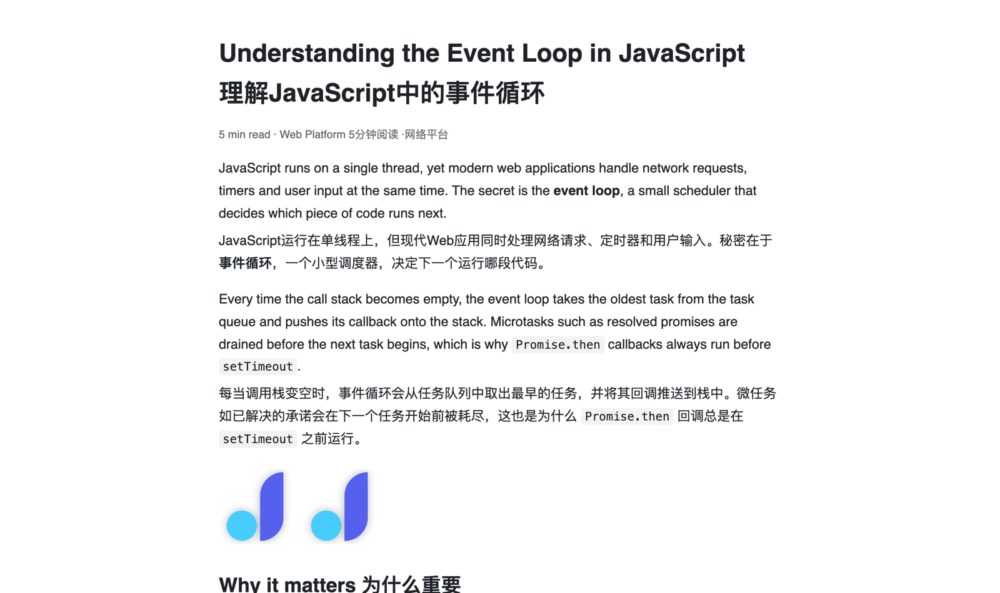

**English** | [简体中文](README.md)

# DevGo

DevGo is a browser extension for developers, focused on translation, GitHub enhancements, a productive new tab page, and page debugging tools.

Install: 👉🏻 [Chrome Web Store](https://chrome.google.com/webstore/detail/devgo/kcofdbjhicjdbmldlcffcijglkifnnjn)

Documentation: 👉🏻 [English](https://fedtop.github.io/dev-go-docs/en/guide/) | [中文](https://fedtop.github.io/dev-go-docs/)

Offline install: 👉🏻 [GitHub Releases](https://github.com/fedtop/dev-go/releases) — unzip, enable Developer mode in `chrome://extensions`, then "Load unpacked".

<p align="center">
  
  
  
</p>

## Features

### Translation

- Full-page bilingual translation: each translation follows its original paragraph, loads as you scroll, and a second click restores the page; works on Shadow DOM / Web Components pages
- Selection toolbar: translate (single words show dictionary results alongside), AI explain / summarize (with paragraph context), and Ask AI; in input fields, AI polish / fix / formal tone with one-click replace
- Custom selection actions: add your own buttons in Settings → Selection — a name, a prompt, an icon, and where it applies (page text / inputs / both); ships with "Translate to English", "Explain the error", and "Convert to JSON" templates. Built-in actions can be hidden; beyond 4 buttons, extras fold into "More"
- Popup dictionary (Youdao / Microsoft / Google / AI), always-translate sites, and hover translation
- Engines: Google, Microsoft (works without a proxy), or any OpenAI-compatible model; translation and chat models are configured separately — a fast one for translation, a stronger one for explain and the assistant

| Full-page bilingual translation | Selection translation |
| --- | --- |
|  |  |

### AI assistant (side panel, `Alt+2` to open / close)

- Summarize the page or extract key points in one click, and ask questions about the page (the AI reads the page content itself); "Ask AI" from the selection toolbar carries the selected text over
- Works with any OpenAI-compatible service and Coding Plan presets; answers stream in with the reasoning shown
- WebMCP: automatically lists tools the page registers via WebMCP (iframes included), and the AI can call them to get things done; tools not declared read-only ask for confirmation first; the side panel's "Page tools" page shows every tool's description and lets you run them with custom arguments (handy for debugging a page's WebMCP implementation). Requires Chrome 150+ with "WebMCP for testing" enabled in `chrome://flags`
- Site tools: add AI-callable tools to any website (search, read a list, fill in and submit a form…). Describe what you need on the side panel's "Page tools" page and the AI inspects the page, test-runs and builds it; or "Record actions" to capture your own steps, across pages, then pick which values become parameters (passwords aren't recorded by default). Tools are pure data steps run by DevGo — no code is executed — and can be exported / imported, including recordings from the Chrome DevTools Recorder


### Network

- One-click switching between Direct / System proxy / Auto / Global proxy, plus your own custom proxy modes; each mode saves its own proxy server and bypass list
- Auto mode: AutoProxy / GFWList rule lists (auto-updated every 6 hours), custom proxy domains, and direct-or-proxy fallback when no rule matches; with no rules at all, everything connects directly
- Real IP protection (WebRTC leak prevention): with a proxy on, sites can still use WebRTC to bypass it and grab your real IP — and from it guess your rough location and carrier. With protection on, sites only see the proxy's IP. You can also disable in-page audio/video calls outright, hide camera and microphone, and run a built-in check. The popup's Network page shows whether protection is active (`privacy` is an optional permission, requested only when you enable it)
- CORS debugging: optionally adds cross-origin response headers to the page's XHR / fetch responses — handy for local development


### Media sniffer & page enhancements

- Sniff images, videos, and audio on the current tab; filter, search, and download individually or in bulk
- Floating dock: a slim DevGo tab on the right edge of every page — hover to expand Translate this page, AI summary, AI assistant, Back to top, and more; drag it up or down, and hide it for now, per site, or everywhere
- The selection toolbar can be turned off per site from the popup's Features page; the disabled-site list lives in Settings → Selection
- Page export: from the popup's Features page, export the page as a full-page PDF or long image that matches the screen (PDF text is selectable and searchable), or pick one area of the page and export it as an image or PDF
- Unlock copy / selection / right-click per site: toggle for the current site in the popup's Features page; manage all sites in Settings → Page enhancements
- GitHub enhancements: floating buttons on code pages (edit online, DeepWiki, back to top); press `,` to open the repo in github1s
- Marks page elements the browser should not auto-translate (GitHub code areas included)

| Media sniffer | Features |
| --- | --- |
|  |  |

### New tab

- Search engine switching + bang syntax (e.g. `!gh`), with search suggestions from quick links and bookmarks
- Quick links with categories, drag-to-sort, and pinned favorites; config imports and exports
- Multiple animated backgrounds; light / dark / auto theme


### Settings & appearance

- Settings live on their own tab: Translation / AI models / Selection / AI assistant / Network / Page enhancements / General; the popup keeps only high-frequency actions related to the current page
- Light / dark / auto theme across the popup, settings, and side panel (Settings → General → Appearance, shared with the new tab page)
- UI in Chinese or English: follows the browser language by default, or switch manually at Settings → General → Appearance → UI language; applies to the popup, settings, side panel, new tab, selection toolbar, and floating dock
- Shortcuts are customizable at `chrome://extensions/shortcuts` and shown in the UI; sync across devices, plus config import / export

| Settings (dark) | Popup (dark) | Side panel (dark) |
| --- | --- | --- |
|  |  |  |

## Tech stack

- Framework: WXT + React + TypeScript
- Styling: Tailwind CSS v4; icons: lucide-react
- Runtime: Chrome MV3 (Firefox build supported)

## Local development

Install dependencies:

```bash
pnpm install
```

Start dev:

```bash
pnpm dev
pnpm dev:firefox
```

Checks:

```bash
pnpm compile
pnpm lint
pnpm format:check
```

Docs screenshots (batch-generated per language × theme — see `scripts/ui-shots/README.md`):

```bash
pnpm shots -- --all
pnpm shots:sync
```

## Build & package

Build:

```bash
pnpm build
pnpm build:firefox
```

Zip:

```bash
pnpm zip
pnpm zip:firefox
```

## Release

`pnpm release` bumps the version, generates the CHANGELOG, and tags; the Chrome Web Store submission flow lives in [docs/publishing.md](docs/publishing.md).

## Project structure

```text
src/
├─ entrypoints/            # WXT entrypoints (manifest is auto-mapped)
│  ├─ background.ts        # Background entry: listeners only; logic in src/background/
│  ├─ translate.content.ts # Full-page inline translation
│  ├─ selection.content.tsx# Selection toolbar (translation + AI actions)
│  ├─ github.content.tsx   # GitHub enhancement UI
│  ├─ unlock.content.ts    # Per-site copy/select unlock
│  ├─ assistant.content.ts # Assistant bridge: read page content, read / run WebMCP tools, run site tool steps
│  ├─ site-recorder.ts     # Site tool recording bar (injected on demand)
│  ├─ capture-picker.ts    # Area picker for page export (injected on demand)
│  ├─ sidepanel/           # Side panel: AI assistant
│  ├─ cors-bridge.content.ts
│  ├─ cors-proxy.ts
│  ├─ popup/
│  ├─ options/
│  └─ newtab/
├─ background/             # Background modules (message routing, proxy, CORS, media sniffing, commands)
├─ api/                    # Translation and dictionary API wrappers
├─ features/               # Feature modules
├─ ui/                     # Shared UI components
├─ utils/                  # Settings, message protocol, theme and shortcut utilities
├─ types/                  # Domain types
└─ assets/                 # Styles and static assets
```

## Contributing

Issues and PRs are welcome — let's make DevGo better together.

Contributors: [Contributors](https://github.com/fedtop/dev-go/graphs/contributors)

<a href="https://github.com/fedtop/dev-go/graphs/contributors">
  
</a>
