# DevGo

DevGo 是一个面向开发者的浏览器效率扩展，聚焦翻译、GitHub 增强、新标签页效率工具与页面调试辅助能力。

下载插件：👉🏻 [Chrome 应用商店](https://chrome.google.com/webstore/detail/devgo/kcofdbjhicjdbmldlcffcijglkifnnjn)

使用文档：👉🏻 [DevGo 使用文档](https://fedtop.github.io/dev-go-docs)

离线安装包：👉🏻 [GitHub Releases](https://github.com/fedtop/dev-go/releases)（解压后在 `chrome://extensions` 开启开发者模式，「加载已解压的扩展程序」）

<p align="center">
  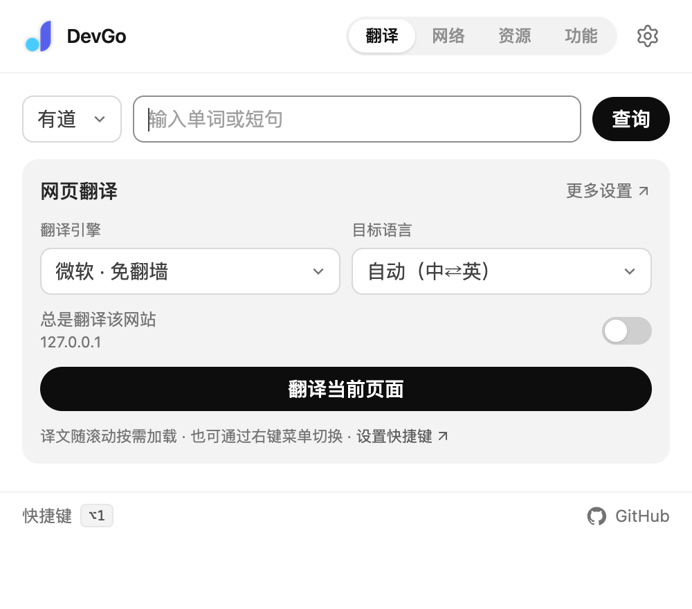
  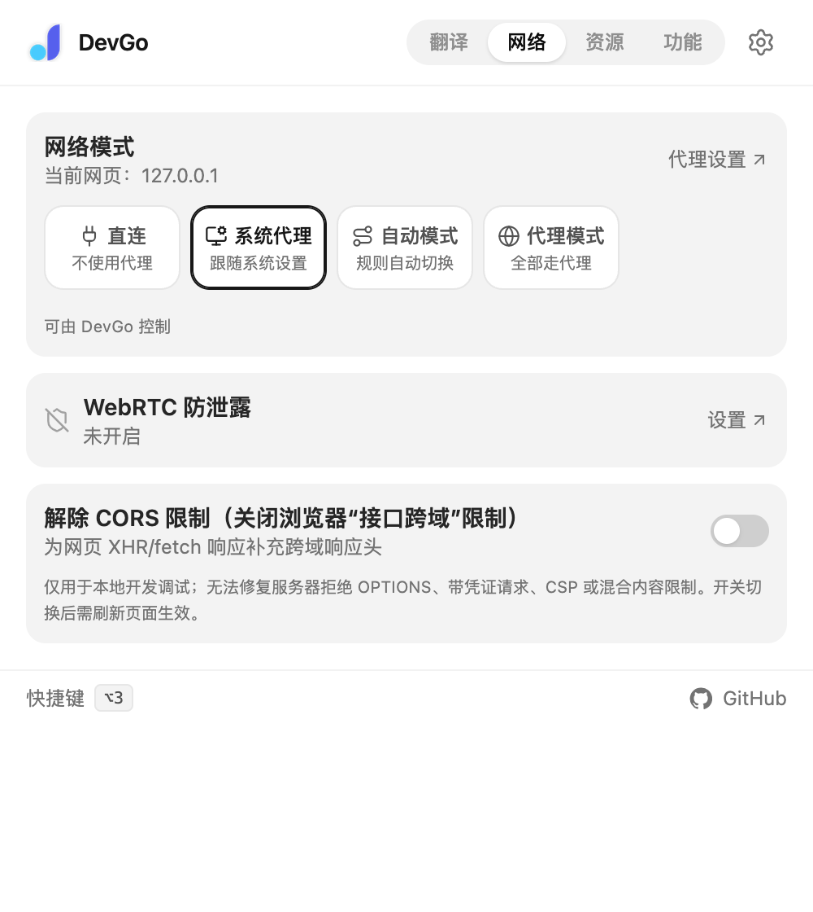
  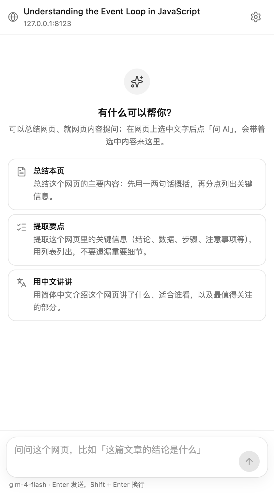
</p>

## 功能概览

### 翻译

- 整页双语对照翻译：译文插在原文段落之后，随滚动按需翻译，再点一次还原；支持 Shadow DOM / Web Components 页面
- 划词工具条：翻译（单词并行展示词典结果）、AI 解释 / 总结（附带段落上下文）、问 AI；输入框里选中文字可以 AI 润色 / 纠错 / 改正式并一键替换
- 划词自定义动作：在设置页「划词」填名称和提示词、选图标和适用范围（网页文字 / 输入框 / 两者），工具条上一键让 AI 按你的要求处理选中内容（自带「译成英文」「解释报错」「转 JSON」示例）；内置动作可隐藏，超过 4 个的动作收进「更多」
- 弹窗查词（有道 / 微软 / Google / AI），总是翻译指定网站，悬停翻译
- 翻译引擎可选谷歌、微软（免翻墙）或任意 OpenAI 兼容大模型；翻译模型与对话模型分开配置：翻译选快的，解释和助手选强的

| 整页双语翻译 | 划词翻译 |
| --- | --- |
| 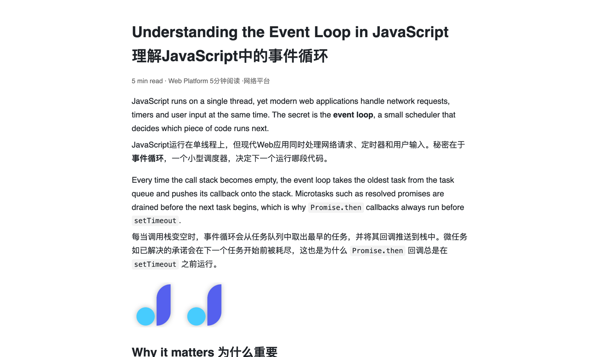 | 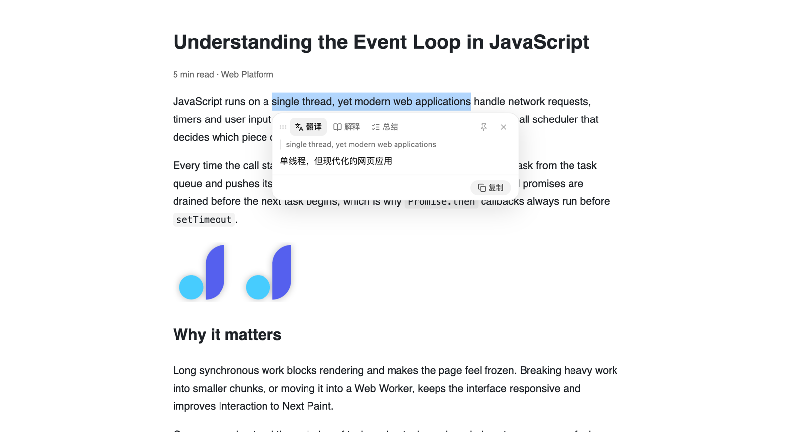 |

### AI 助手（侧边栏，`Alt+2` 打开 / 关闭）

- 一键总结本页、提取要点，就网页内容提问（AI 会自行读取网页正文）；划词「问 AI」会带着选中内容过来
- 支持各家 OpenAI 兼容服务与 Coding Plan 预设，回答流式输出，展示思考过程
- WebMCP：自动列出网页通过 WebMCP 注册的工具（含 iframe），AI 可以调用它们完成任务；没有声明只读的工具执行前会先确认；侧边栏「网页工具」页可以查看每个工具的说明，手动填参数执行（方便调试网页的 WebMCP 实现）（需要 Chrome 150+，并在 `chrome://flags` 开启「WebMCP for testing」）

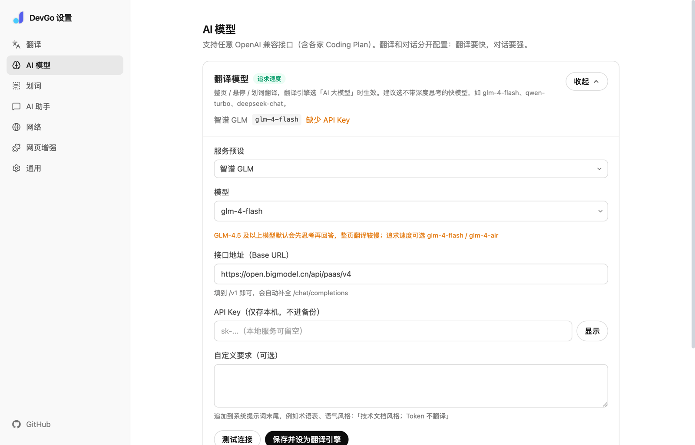

### 网络

- 直连 / 系统代理 / 自动模式 / 代理模式一键切换，也可以新增自定义代理模式；每种模式分别保存代理服务器和绕过列表
- 自动模式：AutoProxy / GFWList 规则列表（每 6 小时自动更新）、自定义代理域名、未命中规则时直连或走代理；没有任何规则时全部直连
- 真实 IP 防护（WebRTC 防泄露）：开着代理时，网站仍可能借助 WebRTC 绕过代理拿到你的真实 IP，进而判断大致位置和运营商；开启后网站只能看到代理的 IP。也可以彻底禁用网页音视频通话、隐藏摄像头和麦克风，内置检测。弹窗「网络」页显示防护是否生效（`privacy` 为可选权限，开启时才申请）
- CORS 调试：可开关地为网页的 XHR / fetch 响应补充跨域响应头，方便本地联调

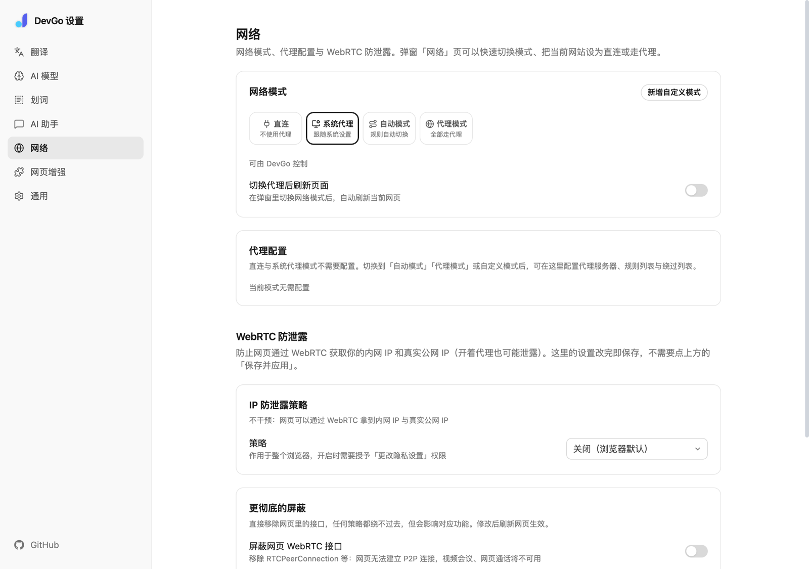

### 资源嗅探与网页增强

- 嗅探当前标签页的图片、视频、音频资源，按类型筛选、搜索，单个或批量下载
- 划词工具条可在弹窗「功能」页对当前网站一键停用，设置页「划词」管理停用列表
- 按站点解除复制 / 选择 / 右键限制：在弹窗「功能」页对当前网站开启，设置页「网页增强」管理全部网站
- GitHub 增强：代码页悬浮按钮（在线编辑、DeepWiki、回到顶部），按 `,` 一键用 github1s 打开
- 标记不应被浏览器自动翻译的页面元素（含 GitHub 代码区）

| 资源嗅探                                 | 功能                                    |
| ---------------------------------------- | --------------------------------------- |
| 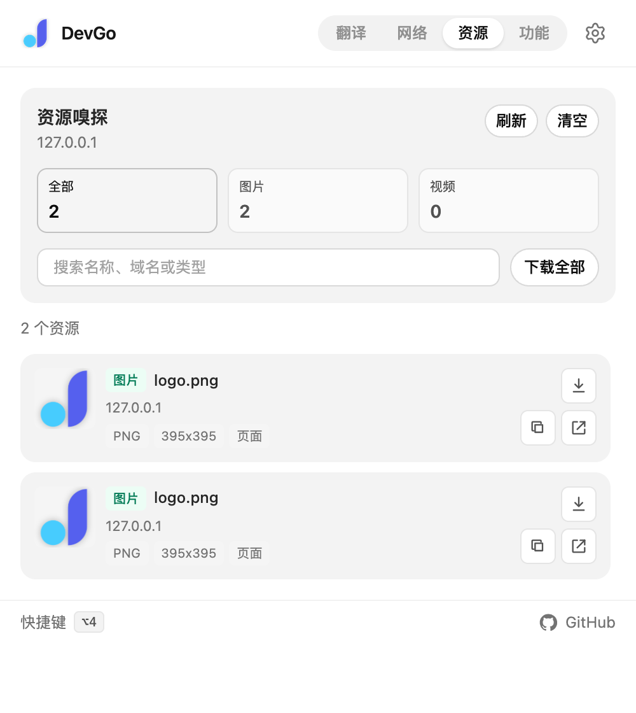 | 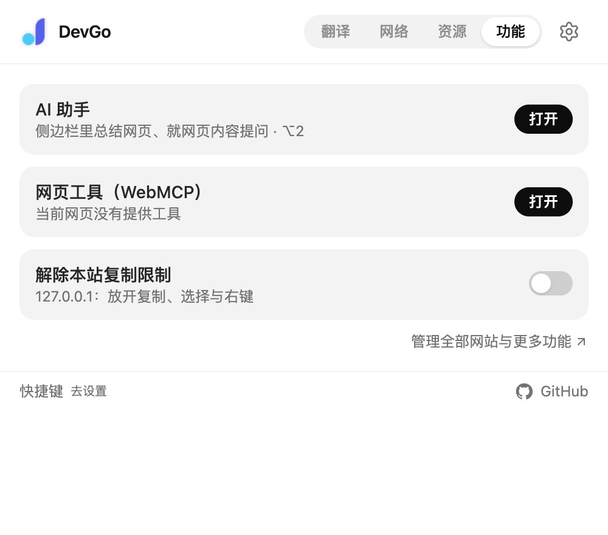 |

### 新标签页

- 搜索引擎切换 + bang 语法（如 `!gh`），聚合导航与书签的搜索联想
- 快捷导航分类管理、拖拽排序、固定常用站点，配置可导入导出
- 多种动态背景，浅色 / 深色 / 自动主题

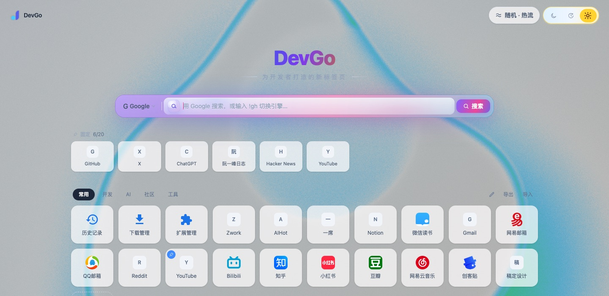

### 设置与外观

- 设置页是独立标签页：翻译 / AI 模型 / 划词 / AI 助手 / 网络 / 网页增强 / 通用；弹窗只放与当前页面相关的高频操作
- 弹窗、设置页、侧边栏支持浅色 / 深色 / 自动主题（设置页「通用 → 外观」，与新标签页共用）
- 快捷键可在 `chrome://extensions/shortcuts` 自定义，界面上会显示当前绑定的按键；支持跨设备同步与配置导入导出

| 设置页（深色） | 弹窗（深色） | 侧边栏（深色） |
| --- | --- | --- |
| 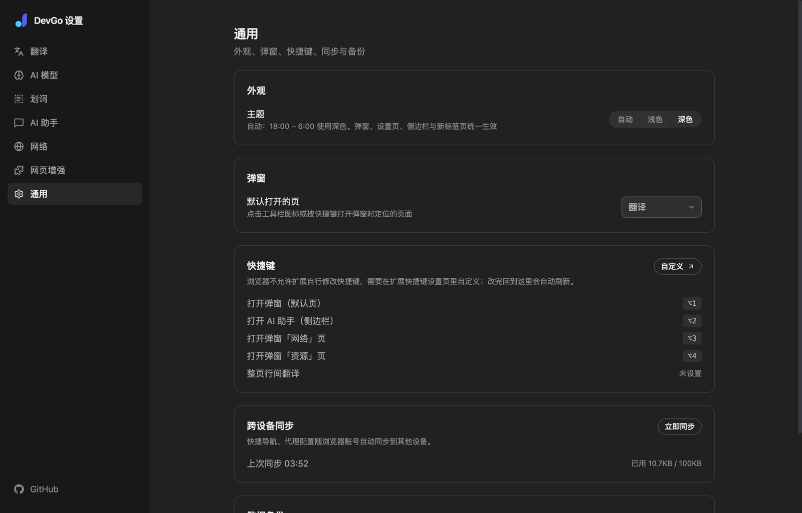 | 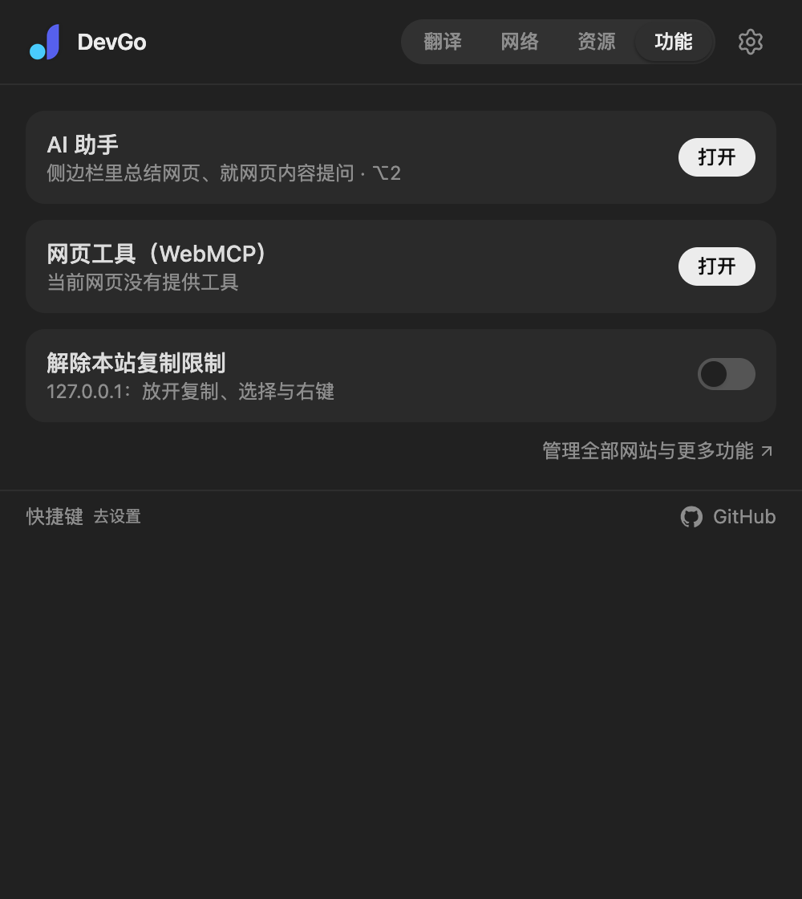 | 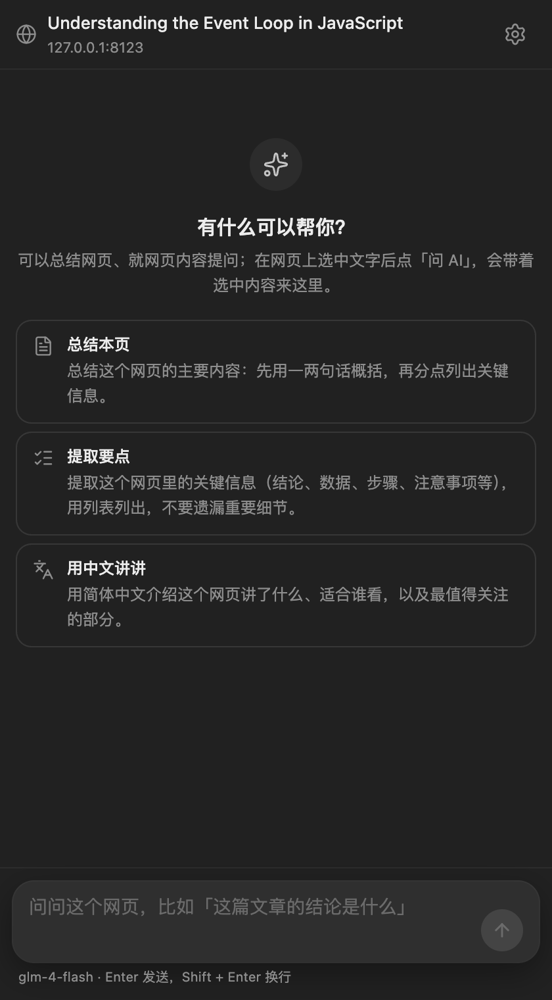 |

## 技术栈

- 框架：WXT + React + TypeScript
- 样式：Tailwind CSS v4，图标：lucide-react
- 运行时：Chrome MV3（支持 Firefox 构建）

## 本地开发

安装依赖：

```bash
pnpm install
```

启动开发：

```bash
pnpm dev
pnpm dev:firefox
```

代码检查：

```bash
pnpm compile
pnpm lint
pnpm format:check
```

## 构建与打包

构建产物：

```bash
pnpm build
pnpm build:firefox
```

打包 zip：

```bash
pnpm zip
pnpm zip:firefox
```

## 发布

`pnpm release` 升版本号、生成 CHANGELOG 并打 tag；提交 Chrome 应用商店的流程见 [docs/publishing.md](docs/publishing.md)。

## 项目结构

```text
src/
├─ entrypoints/            # WXT 入口（自动映射 manifest）
│  ├─ background.ts        # 后台入口：只注册监听，逻辑见 src/background/
│  ├─ translate.content.ts # 整页行间翻译
│  ├─ selection.content.tsx# 划词工具条（翻译 + AI 动作）
│  ├─ github.content.tsx   # GitHub 增强 UI
│  ├─ unlock.content.ts    # 按站点解除复制/选择限制
│  ├─ assistant.content.ts # 助手桥：读取网页正文、读取 / 执行 WebMCP 工具
│  ├─ sidepanel/           # 侧边栏：AI 助手
│  ├─ cors-bridge.content.ts
│  ├─ cors-proxy.ts
│  ├─ popup/
│  ├─ options/
│  └─ newtab/
├─ background/             # 后台各模块（消息路由、代理、CORS、媒体嗅探、命令）
├─ api/                    # 翻译与查词接口封装
├─ features/               # 各功能模块实现
├─ ui/                     # 通用 UI 组件
├─ utils/                  # 设置、消息协议、主题与快捷键工具
├─ types/                  # 业务类型定义
└─ assets/                 # 样式与静态资源
```

## 贡献

欢迎提 Issue 和 PR，共同完善 DevGo。

贡献者列表：[Contributors](https://github.com/wangrongding/dev-go/graphs/contributors)

<a href="https://github.com/fedtop/dev-go/graphs/contributors">
  
</a>
